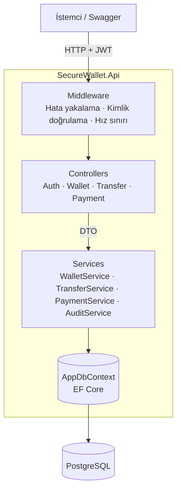
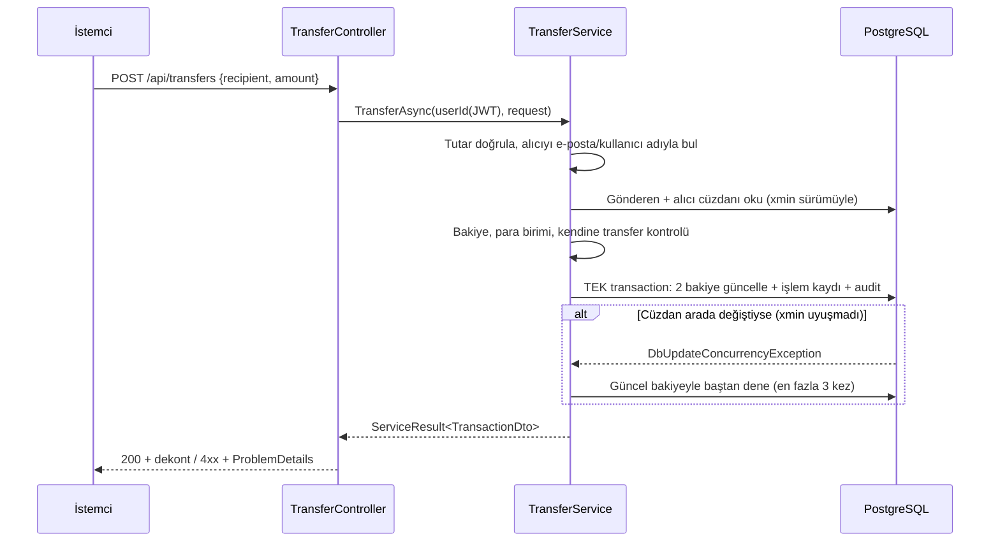
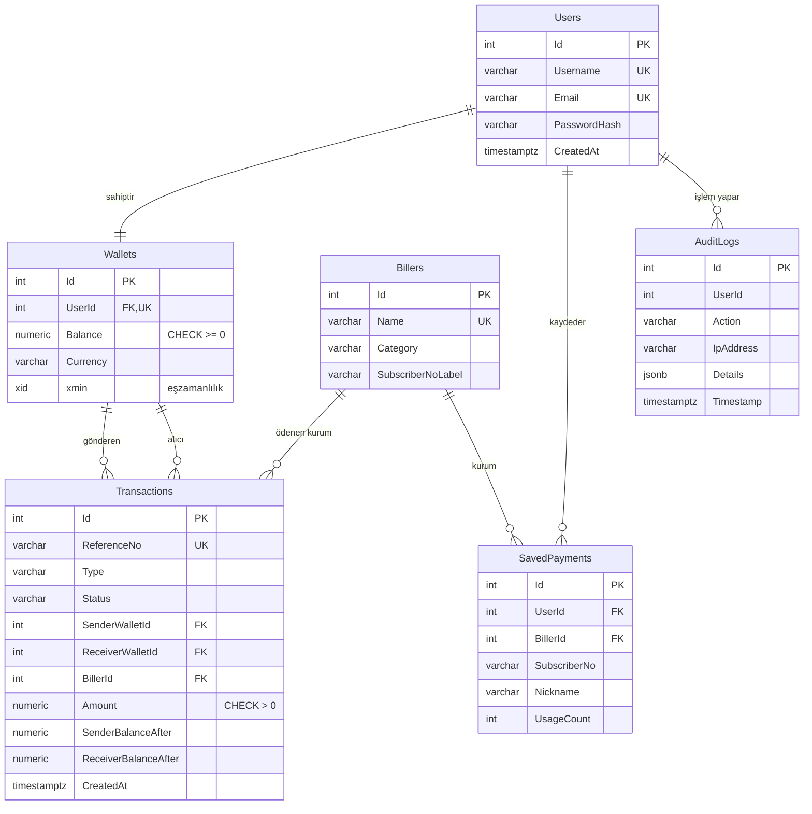

# SecureWallet: Dijital Cüzdan

[](https://github.com/Yusuf-0311/Dijital-Cuzdan-P0010-/actions/workflows/ci.yml)
[](https://github.com/Yusuf-0311/Dijital-Cuzdan-P0010-/actions/workflows/codeql.yml)
[](https://sonarcloud.io/summary/new_code?id=Yusuf-0311_Dijital-Cuzdan-P0010&branch=develop)
[](https://sonarcloud.io/summary/new_code?id=Yusuf-0311_Dijital-Cuzdan-P0010&branch=develop)

Kullanıcıların hesap bakiyelerini yönetebildiği, birbirlerine para transferi yapabildiği, para yatırıp çekebildiği, fatura gibi sık kullanılan ödemeleri tek tıkla yapabildiği ve tüm işlem geçmişini dekontlarıyla görüntüleyebildiği bir dijital cüzdan backend API'si.

Bu proje **Yapay Zeka ile Yazılım Geliştirme** dersi kapsamında geliştirilmiştir.

---

## İçindekiler

1. [Özellikler](#özellikler)
2. [Kullanılan teknolojiler](#kullanılan-teknolojiler)
3. [Mimari](#mimari)
4. [Veri modeli](#veri-modeli)
5. [Kurulum](#kurulum)
6. [API uç noktaları](#api-uç-noktaları)
7. [Testler](#testler)
8. [Kod kalitesi ve güvenlik](#kod-kalitesi-ve-güvenlik)
9. [Yapay zeka kullanımı](#yapay-zeka-kullanımı)
10. [Karşılaşılan zorluklar ve çözümler](#karşılaşılan-zorluklar-ve-çözümler)
11. [Geliştirme süreci](#geliştirme-süreci)
12. [Ekip ve görev dağılımı](#ekip-ve-görev-dağılımı)

---

## Özellikler

| Alan | Özellik |
|---|---|
| Hesap | Kayıt, giriş, JWT ile kimlik doğrulama, şifrelerin hash'lenerek saklanması |
| Cüzdan | Kayıtta otomatik cüzdan oluşturma, bakiye görüntüleme |
| Para hareketleri | Para yatırma, para çekme |
| Transfer | E-posta, kullanıcı adı veya cüzdan Id'si ile transfer; göndermeden önce maskeli alıcı onayı; son alıcılar listesi |
| Ödemeler | Kurum listesi (elektrik, su, doğalgaz, internet, mobil, harç), fatura ödeme, sık kullanılan ödemeleri kaydetme ve tek tıkla ödeme |
| Geçmiş | Sayfalı işlem geçmişi; tip ve tarih aralığına göre filtreleme; karşı taraf ve işlem sonrası bakiye bilgisi |
| Dekont | Referans numarasıyla işlem detayı (yalnızca işlemin tarafları görebilir) |
| Denetim | Tüm para hareketleri IP adresiyle birlikte denetim kaydına (audit log) yazılır |

## Kullanılan teknolojiler

| Katman | Teknoloji |
|---|---|
| Platform | .NET 8, ASP.NET Core Web API |
| Veritabanı | PostgreSQL 15 (Docker) |
| ORM | Entity Framework Core 8 (Code-First, migration'lar) |
| Kimlik doğrulama | JWT Bearer |
| Test | xUnit, Testcontainers (gerçek PostgreSQL ile entegrasyon testi), coverlet |
| CI / Kalite | GitHub Actions, SonarCloud, CodeQL, Dependabot |
| API dokümantasyonu | Swagger / OpenAPI |

## Mimari

Katmanlı mimari kullanılmıştır. Her katman yalnızca bir alt katmana bağımlıdır.



| Katman | Sorumluluk | Klasör |
|---|---|---|
| Controllers | HTTP isteğini alır, kullanıcı Id'sini JWT'den okur, servisi çağırır, sonucu HTTP koduna çevirir. İş mantığı içermez. | `Controllers/` |
| DTO'lar | API'nin dışarıya açtığı veri şekilleri. Veritabanı varlıkları (ör. `PasswordHash`) asla doğrudan dönülmez. | `Dtos/` |
| Services | Tüm iş kuralları: tutar doğrulama, bakiye kontrolü, transfer, eşzamanlılık, audit. Arayüzler (`IWalletService` vb.) üzerinden kullanılır; bu sayede test edilebilir. | `Services/` |
| Data | `AppDbContext`: tablo yapılandırması, kısıtlar, index'ler, örnek veri. EF Core'un `DbContext`'i Unit of Work görevi görür; ayrıca bir Repository katmanı eklenmemiştir (bkz. aşağıdaki karar). | `Data/` |
| Models | Veritabanı varlıkları | `Models/` |

**Önemli tasarım kararları**

- **Repository katmanı yok.** `DbContext` zaten Unit of Work + Repository desenini uyguluyor. Üzerine bir katman daha eklemek kod tekrarına yol açacaktı. Servisler gerçek PostgreSQL'e karşı entegrasyon testleriyle test ediliyor.
- **Hatalar exception ile değil `ServiceResult<T>` ile dönülüyor.** "Yetersiz bakiye" gibi beklenen durumlar hata değil, iş sonucudur. Controller bunu 400/404/409/422 gibi doğru HTTP koduna çevirir. Beklenmeyen hatalar `GlobalExceptionHandler`'a düşer.
- **Para için `decimal(18,2)`.** `float/double` kuruş hatası üretir.
- **Finansal kayıtlar silinmez.** İşlemlerin cüzdanlara bağlantısı `ON DELETE RESTRICT`.

### Para transferi akışı



## Veri modeli



Veritabanı, servis katmanı atlansa bile hatalı veriyi reddeder (savunma derinliği):

| Kısıt | Amaç |
|---|---|
| `CK_Wallets_Balance_NonNegative` | Bakiye eksiye düşemez |
| `CK_Transactions_Amount_Positive` | Sıfır veya negatif tutarlı işlem olamaz |
| `CK_Transactions_Type_Wallets` | Yatırmada sadece alıcı, çekme/ödemede sadece gönderen, transferde ikisi de dolu ve farklı olmalı |
| `CK_Transactions_Payment_Biller` | Ödemede kurum ve abone no zorunlu |
| Unique: `Email`, `Username`, `ReferenceNo`, `Wallets.UserId` | Tekrarlı kayıt engeli |

## Kurulum

Gereksinimler: .NET 8 SDK, Docker.

```bash
git clone https://github.com/Yusuf-0311/Dijital-Cuzdan-P0010-.git
cd Dijital-Cuzdan-P0010-

# 1) Veritabanı şifresini belirle (bu dosya git'e girmez)
cp .env.example .env            # POSTGRES_PASSWORD'ü düzenle
docker compose up -d

# 2) Bağlantı dizesini user-secrets'a yaz (<SIFRE> = .env'deki şifre)
dotnet user-secrets set "ConnectionStrings:DefaultConnection" \
  "Host=localhost;Port=5432;Database=SecureWalletDB;Username=wallet_admin;Password=<SIFRE>"

# 3) Tabloları oluştur ve çalıştır
dotnet tool install --global dotnet-ef --version 8.*   # bir kez
dotnet ef database update
dotnet run
```

Swagger arayüzü: `https://localhost:<port>/swagger` (port `Properties/launchSettings.json` içinde).

Ayrıntılar için [SETUP.md](SETUP.md) dosyasına bakın.

## API uç noktaları

Tüm cüzdan uç noktaları `Authorization: Bearer <token>` ister. Para hareketi yapan uç noktalarda kullanıcı başına dakikada 10 istek sınırı vardır.

| Metot | Yol | Açıklama |
|---|---|---|
| POST | `/api/auth/register` | Kayıt (cüzdan otomatik oluşur) |
| POST | `/api/auth/login` | Giriş, JWT döner |
| GET | `/api/wallet` | Cüzdan ve bakiye |
| POST | `/api/wallet/deposit` | Para yatır `{ "amount": 100, "description": "..." }` |
| POST | `/api/wallet/withdraw` | Para çek |
| GET | `/api/wallet/transactions` | Geçmiş. `?type=Payment&from=2026-11-01&to=2026-11-30&page=1&pageSize=20` |
| GET | `/api/wallet/transactions/{referenceNo}` | Dekont |
| GET | `/api/transfers/recipient?query=` | Alıcıyı doğrula (maskeli ad) |
| POST | `/api/transfers` | Transfer `{ "recipient": "ali@ornek.com", "amount": 50 }` |
| GET | `/api/transfers/recent-recipients` | Son alıcılar |
| GET | `/api/payments/billers` | Kurumlar. `?category=Electricity` |
| POST | `/api/payments/pay` | Fatura öde `{ "billerId": 1, "subscriberNo": "1234567", "amount": 245.5, "saveForLater": true, "nickname": "Ev elektriği" }` |
| GET | `/api/payments/saved` | Kayıtlı ödemeler (en çok kullanılan önce) |
| POST | `/api/payments/saved` | Kayıtlı ödeme ekle |
| DELETE | `/api/payments/saved/{id}` | Kayıtlı ödemeyi sil |
| POST | `/api/payments/saved/{id}/pay` | Kayıtlı ödemeyle öde `{ "amount": 245.5 }` |

Hata yanıtları RFC 7807 `ProblemDetails` biçimindedir:

| Kod | Durum |
|---|---|
| 400 | Geçersiz tutar, eksik alan, kendine transfer |
| 401 | Token yok / geçersiz |
| 404 | Cüzdan, alıcı, kurum veya işlem bulunamadı |
| 409 | Eşzamanlı işlem çakışması, tekrarlı kayıt |
| 422 | Yetersiz bakiye, para birimi uyuşmazlığı, limit aşımı |
| 429 | Hız sınırı aşıldı |
| 500 | Beklenmeyen hata (detay sızdırılmaz, `traceId` döner) |

## Testler

```bash
dotnet test tests/SecureWallet.Api.Tests
```

Docker çalışıyor olmalıdır. Testler kendi geçici PostgreSQL konteynerlerini başlatır, geliştirme veritabanınıza dokunmaz.

| Test grubu | Ne doğrular |
|---|---|
| `Unit/TransactionRulesTests` | Tutar ve abone no doğrulama, isim maskeleme, referans no formatı |
| `Integration/WalletServiceTests` | Yatırma, çekme, yetersiz bakiye, geçmiş filtreleme ve sayfalama, dekont gizliliği |
| `Integration/TransferServiceTests` | E-posta/kullanıcı adıyla transfer, kendine transfer, yetersiz bakiye, para birimi uyuşmazlığı, son alıcılar |
| `Integration/PaymentServiceTests` | Fatura ödeme, kayıtlı ödemeler, kullanım sırası, başkasının kaydına erişim engeli |
| `Integration/ConcurrencyTests` | Aynı anda iki çekimde bakiyenin bozulmaması, paralel yatırmalarda kayıp güncelleme olmaması, karşılıklı transferlerde toplam paranın korunması |
| `Integration/DatabaseConstraintTests` | Negatif bakiye, sıfır tutar, alıcısız transfer, kurumsuz ödeme ve tekrarlı e-postanın veritabanınca reddedilmesi |
| `Integration/ControllerTests` | 13 uç noktanın tamamı: kimliksiz istekte 401, başarılı akışlar, hata kodları (400/404/422) |
| `Unit/ServiceResultExtensionsTests` | Her servis hata kodunun doğru HTTP durum koduna çevrilmesi |
| `Unit/GlobalExceptionHandlerTests` | Beklenmeyen hatada 500 dönülmesi ve SQL/hata detayının istemciye sızmaması |
| `Unit/RequestDtoTests` | Zorunlu sayısal alan eksik gönderildiğinde isteğin reddedilmesi (under-posting) |
| `Unit/ClaimsPrincipalExtensionsTests`, `Unit/ServiceCollectionExtensionsTests` | JWT'den kullanıcı Id'si okuma; tüm servis kayıtlarının eksiksiz olması |

Neden InMemory veritabanı değil? CHECK kısıtları, unique index'ler, `xmin` eşzamanlılık kontrolü ve transaction davranışı yalnızca gerçek PostgreSQL'de çalışır. Bu yüzden entegrasyon testleri Testcontainers ile gerçek PostgreSQL'e karşı çalıştırılır.

## Kod kalitesi ve güvenlik

| Araç | Ne yapar | Nerede |
|---|---|---|
| SonarCloud | Teknik borç, kod kokuları, tekrar, test kapsamı | `.github/workflows/sonarcloud.yml` |
| CodeQL | Statik güvenlik açığı taraması (SQL injection, vb.) | `.github/workflows/codeql.yml` |
| Dependabot | Güvenlik açığı olan bağımlılıklar için otomatik güncelleme PR'ı | `.github/dependabot.yml` |
| `dotnet list package --vulnerable` | Açıklı paket varsa CI'ı kırar | `.github/workflows/ci.yml` |

**Son durum (`develop`):** SonarCloud Quality Gate **geçti**, **0 açık sorun**, yeni kodda **%100 test kapsamı**, **%0 kod tekrarı**, 0 güvenlik bulgusu. İlk analizde 12 sorun ve %71,8 kapsam vardı; nasıl kapatıldığı aşağıdaki "Zorluklar" bölümünde (9-12. maddeler).

Uygulanan güvenlik önlemleri:

- **Gizli bilgiler repoda yok.** Veritabanı şifresi `.env` ve `dotnet user-secrets` ile tutulur. `.env`, `bin/`, `obj/` `.gitignore`'da.
- **Şifreler hash'lenerek saklanır**, düz metin tutulmaz.
- **Yetkilendirme sunucu tarafında yapılır.** Kullanıcı Id'si her zaman JWT'den okunur. İstemci "kimin cüzdanından" para çıkacağını seçemez.
- **Yatay yetki yükseltmeye karşı koruma.** Başkasının dekontu veya kayıtlı ödemesi istendiğinde "bulunamadı" döner (403 bile dönülmez, kaynağın varlığı sızdırılmaz).
- **Eşzamanlılık güvenliği.** PostgreSQL `xmin` ile optimistic concurrency, deadlock ve çakışmada otomatik yeniden deneme.
- **Atomiklik.** Bakiye güncellemeleri, işlem kaydı ve audit kaydı tek veritabanı transaction'ında yazılır.
- **Girdi doğrulama.** Tutar (pozitif, en fazla 2 ondalık, üst limit), açıklama uzunluğu, abone no formatı. Zorunlu sayısal alanlar `[JsonRequired]`: gönderilmezse sessizce `0` kabul edilmez, 400 döner (under-posting koruması).
- **SQL injection yok.** Tüm sorgular EF Core üzerinden parametreli.
- **Hata detayı sızdırılmaz.** `GlobalExceptionHandler` stack trace yerine genel mesaj ve `traceId` döner.
- **Hız sınırı (rate limiting).** Para hareketlerinde dakikada 10 istek.
- **Alıcı onayında isim maskeleme.** E-posta ile kullanıcı adının tamamı öğrenilemez.
- **Denetim kaydı.** Her para hareketi IP ile `AuditLogs`'a yazılır.

## Yapay zeka kullanımı

> Bu bölüm dersin değerlendirme kriteri gereği yapay zekanın projede **nasıl** kullanıldığını açıkça belirtir. Ürünün kendisinde yapay zeka özelliği yoktur; yapay zeka **geliştirme aracı** olarak kullanılmıştır.

| Araç | Kim | Ne için kullanıldı |
|---|---|---|
| Claude (Anthropic) | Yusuf | Mevcut kodun incelenmesi ve eksiklerin tespiti; veritabanı şemasının güçlendirilmesi (FK, CHECK kısıtları, index'ler, eşzamanlılık); servis katmanı ve controller'ların ilk taslağı; test senaryolarının çıkarılması; CI/kalite araçlarının yapılandırılması; README taslağı |
| _[araç adı]_ | _[ortak adı]_ | _[ortağın kullanımı: ör. JWT yapılandırması, doğrulama kuralları]_ |

**Nasıl çalıştık**

1. Önce görev tanımını ve mevcut kodu yapay zekaya verip inceleme istedik. Ortaya çıkan bulgular (repoda açık veritabanı şifresi, `bin/obj` klasörlerinin repoda olması, işlem tablosunda foreign key ve kısıt olmaması, eşzamanlı isteklerde bakiye bozulma riski) öncelik sırasıyla düzeltildi.
2. Yapay zekanın ürettiği kod doğrudan kabul edilmedi. Her değişiklik yerelde derlendi, migration'lar gerçek veritabanına uygulanıp `psql` ile tablo yapısı kontrol edildi.
3. Üretilen kodda hatalar da çıktı ve bunlar düzeltildi (bkz. "Zorluklar" bölümündeki 2, 3, 8 ve 10. maddeler). Bu, yapay zeka çıktısının mutlaka doğrulanması gerektiğini gösterdi.
4. Kritik iş kuralları (yetersiz bakiye, eşzamanlı çekim, başkasının verisine erişim) otomatik testlerle güvence altına alındı.
5. Yapay zekanın yazdığı kod her PR'da **bağımsız araçlarla** (CodeQL, SonarCloud) tekrar denetlendi. Araçların önerileri de körü körüne uygulanmadı: her bulgu tek tek değerlendirildi, biri yanlış alarm olarak gerekçesiyle bastırıldı (11. madde).

**Değerlendirmemiz**

- **Faydalı olduğu yerler:** gözden kaçan güvenlik sorunlarını bulma, PostgreSQL'e özgü özellikleri (`xmin`, `jsonb`) önerme, tekrarlayan kodu hızlı yazma, test senaryosu çıkarma.
- **Dikkat gerektiren yerler:** EF Core'un ürettiği migration'ın PostgreSQL'de çalışmayacağını önceden öngörememesi gibi ortama özgü hatalar; testlerde kaynak kapatmayı unutmak (CodeQL yakaladı); API girdilerinde eksik alan koruması (SonarCloud yakaladı). Yapay zeka kodu çalıştırıp test edemediği için doğrulama sorumluluğu tamamen bizdeydi.
- **Çıkardığımız ders:** Yapay zeka + otomatik test + statik analiz birlikte kullanıldığında hatalar PR aşamasında, ana dala girmeden yakalanıyor.

## Karşılaşılan zorluklar ve çözümler

| # | Zorluk | Çözüm |
|---|---|---|
| 1 | Veritabanı şifresi `appsettings.json` ve `docker-compose.yml` içinde açıkça repoya girmişti. | Şifre `.env` (git'e girmez) ve `dotnet user-secrets`'a taşındı. Eski şifre kullanımdan kaldırıldı. |
| 2 | `AuditLogs.Details` sütununu `text`'ten `jsonb`'ye çeviren migration hata verdi: `column "Details" cannot be cast automatically to type jsonb`. | Migration elle düzenlenip `USING "Details"::jsonb` ifadesi eklendi; boş değerler `'{}'` olarak dönüştürüldü. |
| 3 | Eşzamanlılık için kullanılan PostgreSQL `xmin` sistem sütununu EF Core yeni bir sütun olarak eklemeye çalıştı. | `AddColumn("xmin")` ve `DropColumn("xmin")` satırları migration'dan çıkarıldı; `xmin` her tabloda zaten var. |
| 4 | Aynı cüzdana aynı anda iki çekim isteği gelirse ikisi de eski bakiyeyi okuyup bakiyeyi bozabiliyordu (lost update). | `Wallet.Version` PostgreSQL `xmin`'e eşlendi (optimistic concurrency). Çakışmada işlem güncel bakiyeyle yeniden deneniyor. `ConcurrencyTests` ile doğrulandı. |
| 5 | Transferde iki cüzdan güncellemesinden biri başarısız olursa para kaybolabilirdi. | İki bakiye güncellemesi, işlem kaydı ve audit kaydı tek `SaveChanges` = tek veritabanı transaction'ında yazıldı. |
| 6 | `Wallets.Currency` sütunu modelde `varchar(3)` olduğu halde veritabanında `text` kalmıştı. | `psql \d` ile fark edildi, ayrı bir düzeltme migration'ı (`FixWalletCurrencyLength`) eklendi. |
| 7 | Derleme çıktıları (`bin/`, `obj/`, ~32 MB) repoya girmişti. | `.gitignore` eklendi, `git rm -r --cached bin obj` ile takipten çıkarıldı. |
| 8 | CodeQL, yapay zekanın yazdığı bir testte `StreamReader` nesnesinin kapatılmadığını (kaynak sızıntısı) PR aşamasında yakaladı. | Önerilen `using` düzeltmesi PR içinde uygulandı. Yapay zeka çıktısının bağımsız araçla denetlenmesinin somut örneği. |
| 9 | SonarCloud ilk analizde Quality Gate'i geçmedi: test kapsamı %71,8 (gereken %80). Servisler test ediliyordu ama controller'lar, hata yakalayıcı ve yardımcı sınıflar test edilmemişti. | Controller, hata yakalayıcı ve uzantı testleri eklendi; hiç kullanılmayan `AuditService.LogAsync` silindi; sadece `dotnet ef` araçlarının kullandığı `AppDbContextFactory` gerekçesiyle kapsam dışı bırakıldı. Yeni kodda kapsam %100'e çıktı. |
| 10 | SonarCloud 8 yerde "under-posting" riski buldu: istemci `amount` veya `billerId` göndermezse C# bunu sessizce `0` yapıyordu. | Zorunlu sayısal alanlara `[JsonRequired]` eklendi (eksikse otomatik 400); isteğe bağlı alanlar nullable yapıldı. `RequestDtoTests` ile kanıtlandı. |
| 11 | SonarCloud, alıcı aramasında `ToLower()` yerine `string.Equals(..., OrdinalIgnoreCase)` kullanılmasını önerdi (3 bulgu). Öneri uygulanırsa EF Core sorguyu SQL'e çeviremediği için transfer çalışma anında hata verecekti. | Öneri **uygulanmadı**: tekrarlanan sorgu tek metoda (`WalletsMatching`) toplandı, kural sadece o satırda bastırıldı ve gerekçesi koda yazıldı. Araç önerilerinin de değerlendirilmesi gerektiğinin örneği. |
| 12 | `Program.cs`'te senkron `app.Run()` kullanılıyordu (SonarCloud). | `await app.RunAsync()` olarak değiştirildi. |
| _13_ | _[ortağın karşılaştığı zorluk: ör. JWT yapılandırması]_ | _[çözüm]_ |

## Geliştirme süreci

- **Dallar:** `main` (teslim), `develop` (entegrasyon), `feat/*`, `fix/*`, `test/*`, `ci/*` (özellik dalları).
- Her özellik ayrı bir dalda geliştirilip **Pull Request** ile `develop`'a birleştirilir. PR şablonu `.github/pull_request_template.md` içindedir.
- Her PR'da CI (derleme + testler), CodeQL ve SonarCloud otomatik çalışır. Kontroller geçmeden birleştirme yapılmaz.
- Örnek akış: veritabanı düzeltmeleri → servisler → API uç noktaları → testler → CI/dokümantasyon → kapsam testleri → statik analiz bulgularının düzeltilmesi (her biri ayrı PR).

## Ekip ve görev dağılımı

| Üye | Sorumluluk |
|---|---|
| Yusuf | Veritabanı mimarisi, cüzdan bakiye yönetimi, transfer servisleri, fatura ödemeleri, işlem geçmişi ve dekont, testler, CI |
| _[ortak adı]_ | Kullanıcı kaydı ve girişi (`AuthController`), JWT üretimi, şifre hash'leme, girdi doğrulama |
